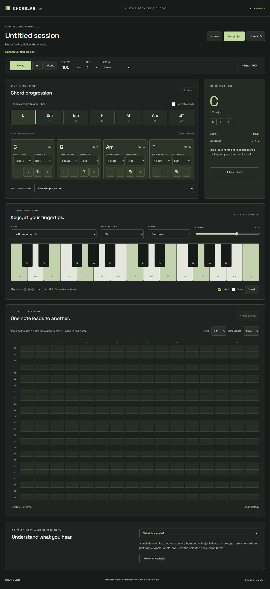
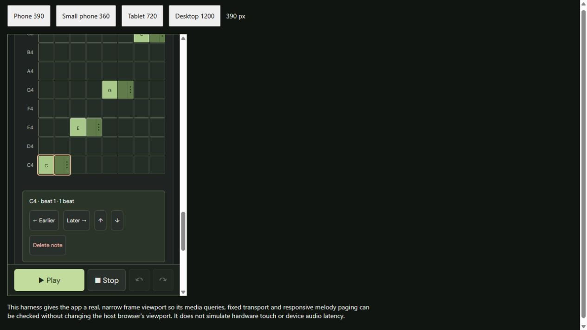

# CHORDLAB

**A little room for big ideas.** A browser-local music workspace for exploring harmony, playing a polyphonic instrument, and composing short chord-and-melody sketches.

[Open the studio](https://hosannaute.github.io/chordlab/) · [Test and build](https://github.com/hosannaute/chordlab/actions/workflows/ci.yml) · [Deployment](https://github.com/hosannaute/chordlab/actions/workflows/pages.yml)



<details><summary>Compact melody editor and phone playback controls</summary>



</details>

## What you can do

- Explore major and natural minor in all 12 chromatic keys, with contextual enharmonic spelling, diatonic triads and seventh chords.
- Build progressions with individual previews, durations, inversions, duplication, removal, and accessible move controls. Five starting ideas include ii–V–I and i–VI–III–VII.
- Inspect each chord's notes, Roman numeral, semitone formula and musical function.
- Play one or two octaves with mouse, touch pointers or the computer keyboard. Use sustain, volume, octave selection, labels and scale highlighting.
- Choose Soft Piano, Electric Piano, Synth Pad, Plucked Synth or Organ. **All are synthesized interpretations, not sampled instruments.** No audio samples, paid APIs or account are required.
- Compose a melody on a half-beat grid; move, resize and delete notes; play it alone or with chords. Phone layouts show one bar per page; larger layouts show two.
- Undo/redo up to 100 composition edits, including clearing a part or replacing a progression. Consecutive typing changes are grouped, and undo tracks the saved composition accurately.
- Start with a compact scale-note melody view, reveal chromatic notes, and drag notes or their right edges to move/resize them. Editing buttons and keyboard navigation remain available.
- Keep Play, Stop, Undo and Redo within reach using the fixed phone playback bar. Sound and keyboard settings fold away on smaller screens.
- Play, stop, loop and adjust tempo. Changing tempo affects newly scheduled notes; notes already sounding keep their scheduled release.
- Save, rename, reopen and delete multiple local projects. Import/export validated version-2 JSON backups.
- Export standard format-1 MIDI with a tempo/time-signature track and separate chord/melody tracks.
- Learn eight short theory topics with audio examples.

## Run locally

Use Node.js **22.12+** or a supported newer LTS release, plus npm.

```sh
git clone https://github.com/hosannaute/chordlab.git
cd chordlab
npm ci
npm run dev
```

Open the printed URL, normally `http://127.0.0.1:5173/chordlab/`. ES modules require an HTTP server; opening `index.html` directly is no longer supported.

| Command | Purpose |
| --- | --- |
| `npm run dev` | Local development with Vite |
| `npm test` | Node unit tests for theory, projects, storage, audio lifecycle, scheduling and MIDI |
| `npm run build` | Production files in `dist/` |
| `npm run preview` | Serve the compiled production build |

No runtime package dependencies. The application uses vanilla JavaScript ES modules, semantic HTML, CSS, Web Audio, Pointer Events, Blob downloads, and localStorage. Vite is the only direct development dependency. Optional Google Fonts requests improve typography; system fonts are the fallback. Composition data is never uploaded by the app.

## First sketch

1. Pick a key and scale. Tap chord buttons to add and hear them.
2. Change each chord's length and inversion. Use the arrow controls to reorder.
3. Add melody notes to the grid. Select a note to change its length or use its move/delete controls.
4. Press Play to hear both parts. Loop repeats the entire composition, including any melody extending past the chords.
5. Name the project and press Save. Use Library → Export JSON for a portable backup, or Export MIDI to continue in another music tool.

Changing the key transposes the melody by the shortest semitone distance as well as rebuilding the diatonic chords. Changing major/minor changes chord harmony but deliberately keeps melody pitches. Exported MIDI includes one composition pass; the loop setting is for preview only.

### Keyboard access

`A W S E D F T G Y H U J K O L P ;` play consecutive semitones from the selected starting C. Hold Space for sustain when focus is outside an input or button, or use the Sustain toggle. Input fields keep normal typing behavior. Piano buttons also support normal Enter/Space activation. The melody grid uses a single Tab stop with arrow navigation, Home/End within a row, and Enter/Space to add/select a note. All destructive library actions ask for confirmation.

Outside text fields, Ctrl/Command+Z undoes a composition edit; Ctrl/Command+Shift+Z or Ctrl+Y redoes it. Delete/Backspace removes a focused melody note. Clearing a part and replacing a preset are now reversible without confirmation; deleting a saved library project still asks first. Undo history is local to the currently open project and is reset when opening another project.

## Architecture

The original one-file implementation was refactored without adding a UI framework. Pure music/data modules remain independent from browser controls.

```text
src/
  theory.js    scales, contextual spelling, chord qualities, inversions, transposition
  project.js   versioned schema, validation, legacy migration, composition event timeline
  audio.js     synthesized voices, envelopes, master gain, compressor and graph cleanup
  playback.js  audio-clock lookahead scheduler, loop and cancellation
  piano.js     pointer/keyboard ownership, sustain, pressed-state rendering
  storage.js   local project library and JSON import
  midi.js      format-1 SMF encoding at 480 ticks per quarter note
  lessons.js   short beginner-friendly explanations
  history.js   bounded undo/redo snapshots and grouped typing edits
  melody.js    validated note edits, scale rows and responsive page mapping
  main.js      application state, DOM components, editing and downloads
  style.css    responsive workspace, touch controls and visible focus
test/          unit tests with no testing-framework dependency
docs/          initial audit, verification notes, audio harness and screenshots
```

Audio initializes and resumes after user interaction. Each note owns its oscillators and envelope; release disconnects the complete graph. A 32-voice budget, conservative per-voice gain, normalized harmonics and a master compressor manage polyphony/headroom. Live piano ownership uses independent pointer and keyboard IDs, so releasing one input does not release another. Pending initialization cannot resurrect a released note. Stop, window blur and document hiding release sound; playback does not continue in the background.

The scheduler wakes every 25 ms and schedules approximately 120 ms ahead using `AudioContext.currentTime`. It does not preload an entire composition. UI editing stops playback so a composition cannot silently diverge from the audible timeline. Rapid stop/start uses a generation guard to cancel pending audio initialization.

### Music theory

Major uses `[0,2,4,5,7,9,11]`; natural minor uses `[0,2,3,5,7,8,10]`. Diatonic chords stack every other scale degree while preserving octave offsets. The engine supports major, minor, diminished and augmented triads, plus major, minor, dominant and half-diminished sevenths. Augmented triads are available in the theory API; the chord palette deliberately contains only diatonic chords.

Pitch classes and spelled note names are separate. A scale advances through seven distinct letters and applies sharps/flats as required, including E♯ in F♯ major. Natural minor correctly uses **v**, not a major V. Inversions rotate the lowest chord tones up an octave; changing an inversion never changes its harmonic identity.

### Storage and MIDI

The `chordlab-projects-v2` library holds up to 100 projects, each with at most 128 chords and 512 melody notes. The melody timeline spans 128 beats and MIDI pitches 36–95. Imports validate numeric ranges, durations, scale, instrument, version, nested entries and file size. Imported IDs are regenerated to avoid overwriting existing projects.

The old `chordlab-v1` save is recoverable when no v2 library exists. Its original key is retained. Invalid existing data is reported and never silently overwritten. Writes are explicit; export JSON before clearing browser data or changing devices/origins. The library is local to each browser origin and is not cloud-synchronized.

MIDI uses format 1, 480 PPQN, microseconds-per-quarter-note tempo and 4/4 meter. Note-off events precede note-ons at shared ticks. Same-pitch overlaps on a track merge to avoid early cutoffs. Tracks preserve the full composition length, including silence. General MIDI program suggestions do not reproduce the app's synthesis timbres or sustain pedal gestures.

## Verification

Run `npm test` and `npm run build`. Unit tests cover all twelve keys in both modes, enharmonic spelling, seventh qualities, inversions, migration, rejected files, save/update/delete, transposition, duration timelines, decoded MIDI events, bounded voices, cleanup, scheduler lookahead, looping and cancellation.

For real browser DSP checks, run the dev server and open `/chordlab/docs/audio-check.html`. Press **Run audio verification**. The harness renders the actual Web Audio graph with `OfflineAudioContext` for all five presets, checking nonzero finite signal, peak headroom, silent tails, released voices and cancellation before a scheduled onset. The harness is a developer page, not part of the production bundle.

See [verification notes](docs/VERIFICATION.md) for actual results and remaining device checks. A successful unit test is not a substitute for checking touch behavior or listening on target hardware.

## GitHub Pages

Vite's base path is `/chordlab/`. The Pages workflow installs from the lockfile, runs tests, builds, uploads `dist/`, and deploys through GitHub's Pages action. The separate CI workflow checks pull requests and main-branch changes.

For a fork, change the base path if the repository name changes. Select **Settings → Pages → Build and deployment → Source → GitHub Actions**, then push to `main` or run **Deploy GitHub Pages** manually. The production address for this repository is `https://hosannaute.github.io/chordlab/`.

## Known limitations and next steps

- Physical Android multitouch, device audio latency, speaker quality, Safari/iOS behavior and screen-reader workflows still require target-device testing.
- The sounds are intentionally simple synthesis. There is no sampled acoustic piano, recording, audio export, MIDI hardware input, velocity editor or effects rack.
- Timing is a fixed half-beat grid in 4/4. Melody length is limited to 32 bars; chord timelines can be longer. Large sessions may need additional profiling on older phones.
- Tempo changes affect future scheduling; held voices retain their existing duration. Preview timbres and pedal gestures are not embedded in MIDI.
- No collaboration or cloud storage. Chord reordering uses accessible move controls; melody notes support pointer dragging as well as editing controls.
- Local save data can be removed by browser cleanup/private mode. JSON exports are the supported backup/transfer mechanism.
- Key choices cover all pitch classes using a practical spelling; there is no separate enharmonic-key selector. Harmonic/melodic minor and borrowed chords are future additions.
- The piano initially shows one octave on phones; its range remains user-selectable. Melody paging adapts when crossing the phone breakpoint, preserving the visible beat.

Useful next improvements are automatic draft recovery, physical-device regression checks, smoother duration changes during tempo edits, MIDI input and optional offline installation. See [the usability update](docs/USABILITY.md) for the current editing behavior.

## License

[MIT](LICENSE). No third-party audio samples are included.

Technical references: [Web Audio specification](https://webaudio.github.io/web-audio-api/), [Standard MIDI Files](https://midi.org/standard-midi-files), and [GitHub Pages custom workflows](https://docs.github.com/en/pages/getting-started-with-github-pages/using-custom-workflows-with-github-pages).
